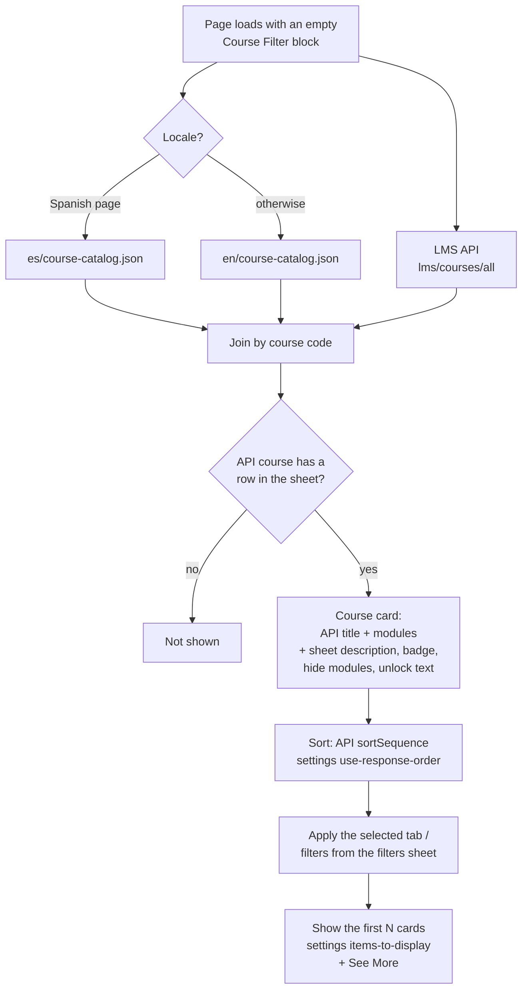
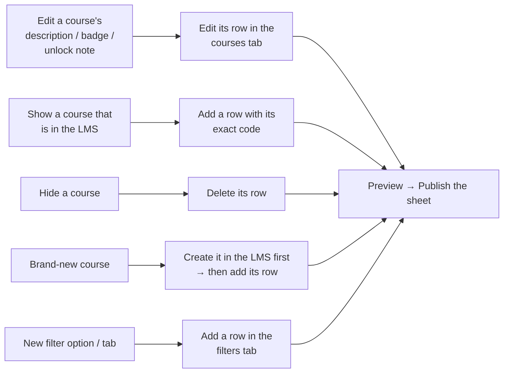
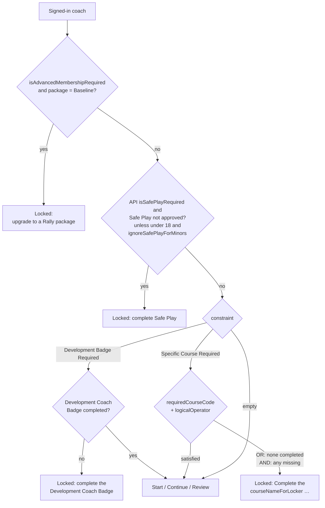

# course-filter

The USTA Coaching **course browser** (source: `/en/home/courses.html` → "Courses and Workshops"):
persona tabs, a *Filter By* panel, *Sort by*, and a grid of course cards that expand to their
module timeline, paged with *See More*.

It replaces the source's AEM **Content Fragments + Vue component** with an EDS block that reads
two things at runtime:

| Data | Where it comes from | Who edits it |
|---|---|---|
| Course **titles, module lists, filter tags, sort order** | USTA LMS API `GET https://services.ustacoaching.com/v1/lms/courses/all` (live, public) | USTA's course system (not authors) |
| Course **descriptions, badges, flags, prerequisites, unlock text**, the **tabs / filters** and **settings** | DA sheet `/en/course-catalog.json` (Spanish: `/es/course-catalog.json`) | Authors, in Document Authoring |
| Badge images | DA `/assets/media/course-catalog/badges/` | Authors |

The block itself has **no rows** — on a page it is an empty `Course Filter` block.

---

## How it works

1. **Load** — the API and the locale's sheet are fetched in parallel.
2. **Join** — each API course is matched to the sheet row with the same `code`.
   **Only API courses that have a sheet row are shown** (as on the source: no fragment → no card).
   If the sheet cannot be loaded at all, every API course is shown without description / badge.
3. **Card** — title, eyebrow (`N modules`, Spanish courses `N módulos`) and module timeline come from
   the API; description, badge and the unlock note from the sheet. `hideModules = true` shows
   `0 modules` and no timeline (workshops).
4. **Filter & sort** — the tabs and the *Filter By* panel are built from the `filters` sheet; a tab is
   one option of its filter group (tab, checkbox and chip always agree). Options in different groups
   narrow the list (AND); options in the same group widen it (OR). Sort: Default (API order), A–Z, Z–A.
5. **Page** — the first `items-to-display` cards, then *See More* adds the same number again.

---

## The sheet: `/en/course-catalog.json` (and `/es/…`)

One DA spreadsheet with three tabs. Edit it in DA, then **preview** (and **publish**) it — the page
picks up the change on the next load; no code change, no page edit.

### Tab `courses` — one row per course (= one AEM Content Fragment)

| Column | AEM fragment field | Used by the block | Notes |
|---|---|---|---|
| `code` | Code | **Join key** | Must equal the LMS course code exactly (e.g. `ACS-B1009`). |
| `courseName` | — | no (reference only) | The title shown comes from the API. Here only to help authors find the row. |
| `description` | Description | yes | **Plain text** — see *Writing descriptions*. |
| `logoPath` | Logo Path | yes | Badge image, e.g. `/assets/media/course-catalog/badges/cardio-tennis.png`. Empty = no badge. |
| `sourceLogoPath` | (the AEM DAM path) | no | Traceability only. |
| `isAdvancedMembershipRequired` | "Rally or above" | stored* | `true` / `false` |
| `ignoreSafePlayForMinors` | Ignore SafePlay for minors (under 18) | stored* | `true` / `false` |
| `hideModules` | Hide modules | yes | `true` → `0 modules`, no timeline. |
| `constraint` | Constraint | stored* | empty, `Development Badge Required` or `Specific Course Required` |
| `requiredCourseCode` | Required Course Code | stored* | comma-separated codes, e.g. `DEP-B1005, DEP-B1005-GC` |
| `logicalOperator` | Logical Operator | stored* | `OR` or `AND` |
| `courseNameForLocker` | Course Name For Locker | stored* | the name put into the locked-button text |
| `conditionalDescription` | Conditional Description | yes | the "To unlock this course…" note, shown under the description (plain text). |

\* *stored* = read by the block and kept on each card (`course.rules`) for the **signed-in states**
(Start / Continue / Locked / Review). Those need sign-in on EDS and the user-status APIs — see
*Prerequisites and locks*. Signed-out visitors (everyone today) see what the source shows them:
the description and the unlock note.

Rows whose code ends in `-GC` (grandfathered courses) are only returned by the signed-in API; they
are kept for completeness and have no effect today.

### Writing descriptions (no HTML)

- Plain text. A blank line starts a new paragraph.
- Links: `[the words to show](https://the-address)` — underlined; links to other sites open in a new tab.
  Example: `Also available in [Spanish](https://ustacoaching.csod.com/…).`
- Do **not** add an empty line before the unlock note — the block adds that space itself.

### Tab `filters` — the tabs and the *Filter By* panel

| Column | Meaning |
|---|---|
| `sectionTitle` | the group heading in the panel (`Coach type`, `Certification`, `Membership package`, `Languages`) |
| `filtersDataPath` | which API field the group tests: `filters.coachTypes`, `filters.certifications`, `filters.membershipPackages`, `language` |
| `filterTitle` | the option label (and its chip) |
| `filterValue` | the API value(s) to match; **comma-separated = any of them** (e.g. `FT_PROF_COACH, PT_PROF_COACH, COLLEGE_COACH, VOLUNTEER_OR_EMERGING_COACH`) |
| `addToTopFilters` | `true` → also a **tab** above the cards |
| `appliedByDefault` | `true` → selected on load (today: *Coaches*) |
| `topFilterTitle`, `topFilterDescription` | the tab's title and line (e.g. *Coaches* / *I coach a team or individuals.*) |

An option that **no course carries** is shown disabled (the *Coming Soon* certifications) — it turns
on by itself once the API tags a course with that value.

### Tab `settings`

| Key | Used | Meaning |
|---|---|---|
| `items-to-display` | yes | cards per page (16) |
| `show-more-button-title` | yes | the *See More* label |
| `empty-message` | yes | shown when no course matches |
| `use-response-order` | yes | `true` = API sort order; `false` = the row order of the `courses` tab |
| `url-filter-parameter`, `hide-description`, `hide-badge-path`, `hide-eyebrow`, `hide-modules` | no | recorded from the AEM component; not wired yet |

---

## Common tasks

- **Edit a course** — change `description`, `logoPath`, `hideModules` or `conditionalDescription` in its
  row. Preview → publish.
- **Add (show) a course** — the course must already exist in the LMS API (titles, modules and filter tags
  live there). Add a row with its exact `code`; fill `description` (and `logoPath` if it has a badge).
  A row whose code the API doesn't return shows nothing.
- **Create a brand-new course** — create it in USTA's LMS first (the sheet cannot create titles or
  modules), then add its row.
- **Hide a course** — delete its row (the API may keep returning it; without a row it isn't shown).
- **New badge image** — upload the PNG (2× size, e.g. 296 px for a 148 px badge) to
  `/assets/media/course-catalog/badges/`, preview it, then set the row's `logoPath`.
- **New filter option or tab** — add a `filters` row with the API value; set `addToTopFilters` for a tab.
  The value must be one the API uses in that field.
- **Change the default tab** — move `appliedByDefault = true` to another option.
- **Spanish** — the same changes in `/es/course-catalog.json` (Spanish pages read it automatically).

---

## Prerequisites and locks (e.g. "Applied Coaching Skills: Group")

Every field of the AEM fragment's *Constraint* section is a column of the course's row. For
**Applied Coaching Skills: Group** (`ACS-B1009`):

| AEM fragment field | Sheet column | Value |
|---|---|---|
| Rally or above required | `isAdvancedMembershipRequired` | `true` |
| Hide modules | `hideModules` | `false` |
| Constraint | `constraint` | `Specific Course Required` |
| Required Course Code | `requiredCourseCode` | `DEP-B1005, DEP-B1005-GC` |
| Logical Operator | `logicalOperator` | `OR` |
| Course Name For Locker | `courseNameForLocker` | `Developing Junior and Adult Players Badge` |
| Conditional Description | `conditionalDescription` | `To unlock this course you will have to complete the Developing Junior and Adult Players Badge and have a Rally or above package.` |

So yes — authors set up a group course (or any locked course) entirely in the sheet. What each
visitor sees:

- **Signed out (today, everyone):** the card with its description and the unlock note — exactly what
  the source shows a signed-out visitor.
- **Signed in (source behaviour, not built on EDS yet):** the rules decide the card's button:

(`OR` = completing **any one** of the codes unlocks; `AND` = **all** must be completed. The `-GC` code
lets grandfathered completions count.) Building the signed-in states needs EDS sign-in plus the
user APIs the source calls: `/profile/lightweight`, `/lms/courses/me/achievements`,
`/lms/courses/me/{code}/status`, `/lms/courses/me/all`.

---

## For developers

- Files: `course-filter.js` (data load, join, filters, cards), `course-filter.css`.
- Catalog URL: `${localePrefix() || '/en'}/course-catalog.json` (multi-sheet JSON: `courses`, `filters`,
  `settings`).
- Description cells: plain text + `[text](url)` (rendered with `createElement`, http/https/mailto only);
  a cell that still holds HTML renders through an allow-list — never `innerHTML`.
- Re-export from the live source: `node tools/importer/course-filter/export-course-catalog.mjs`
  (reads the AEM props on `/en|es/home/courses.html`). **It overwrites the local sheets** — use it to
  re-seed, not after authors have edited DA.
- Not authorable yet: the *Filter By* / *Sort by* / *Apply filters* / sort-option labels and the
  module words are in the code (English; Spanish module words).
- History and parity notes: `MIGRATION.md` (course-filter entries).
